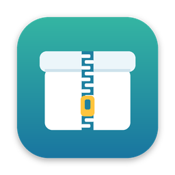

<p align="center">
  
</p>

<h1 align="center">7zMac</h1>

<p align="center">基于 7-Zip 源码的 macOS 原生压缩 / 解压工具：右键一键压缩、智能解压，双击压缩包直接浏览。</p>

---

## 功能

- **Finder 右键一级菜单**：只有「压缩」「解压」两项，不藏在“快速操作”子菜单里。
- **一键压缩**：按设置里的默认格式和参数，在原位置生成压缩包，不弹对话框。
- **智能解压**：解压到当前文件夹——
  - 压缩包里只有一个文件或一个文件夹 → 直接放出来；
  - 有多个项目 → 自动新建与压缩包同名的文件夹；
  - `.tar.gz` / `.tar.xz` 等双层包一次解开；自动清理 `__MACOSX`、`.DS_Store`。
- **后台运行**：右键操作不打开主窗口、不出现在 Dock；耗时任务在右上角显示进度，可取消。
- **双击浏览**：关联常见压缩格式，双击打开浏览窗口，支持搜索、双击预览、拖出到 Finder、解压选中项。
- **中文 ZIP 不乱码**：给 7-Zip 打了补丁，Windows 中文系统打出的 GBK 文件名 ZIP 也能正确显示。
- **格式**：解压支持 7z、zip、rar、tar、gz、bz2、xz、zst、cab、iso、wim 及分卷等；压缩支持 7z、zip、tar.gz、tar.xz，可加密（AES-256）、分卷。

## 安装

### 下载 DMG

到 [Releases](../../releases) 下载 `7zMac-x.y.z.dmg`，打开后把 7zMac 拖进「应用程序」。

由于没有使用付费的 Apple 开发者 ID 公证，首次打开时 macOS 会拦截：

1. 打开一次「应用程序」里的 7zMac，提示无法验证时点「完成」；
2. 打开「系统设置 › 隐私与安全性」，在页面下方点「仍要打开」。

或者在终端执行一次：

```bash
xattr -dr com.apple.quarantine /Applications/7zMac.app
```

### 启用右键菜单

「系统设置 › 通用 › 登录项与扩展 › 访达扩展」中勾选 **7zMac**。

### 设为默认解压工具（可选）

打开 7zMac → 设置 → 通用 → 「设为默认解压工具」。

## 从源码构建

需要 macOS 13+ 和完整的 Xcode（App Store 安装）。

```bash
git clone git@github.com:djj45/7zMac.git
cd 7zMac
bash scripts/build-app.sh      # 编译 7zz → 生成工程 → 编译 → 安装到 /Applications
```

- 第一次运行会下载 7-Zip 源码、打补丁并编译 Universal（arm64 + x86_64）的 `7zz`，之后会复用。
- 如果 Xcode 里登录了 Apple ID 并创建了 Apple Development 证书，会自动用它签名；否则使用 ad-hoc 签名。
- 需要代理时，新建 `scripts/local.env`（已被 Git 忽略）：

  ```bash
  export http_proxy="http://127.0.0.1:端口"
  export https_proxy="http://127.0.0.1:端口"
  ```

打包 DMG：

```bash
bash scripts/make-dmg.sh       # 输出 dist/7zMac-<版本>.dmg
```

## 发布新版本

1. 修改 `project.yml` 里的 `MARKETING_VERSION`；
2. 提交后打标签并推送：

   ```bash
   git tag v1.0.0
   git push origin v1.0.0
   ```

GitHub Actions（`.github/workflows/release.yml`）会在 macOS 机器上自动构建 DMG 并发布到 Releases。

## 项目结构

```
App/                主程序（Swift，AppKit + SwiftUI）
  Engine/           7zz 调用、列表解析、智能解压、压缩、任务队列、设置项
  UI/               浏览窗口、设置窗口、进度面板、对话框
FinderExt/          Finder Sync 扩展（右键菜单）
Shared/             主程序与扩展共用（后缀识别、任务请求）
scripts/            构建脚本
vendor/patches/     对 7-Zip 源码的补丁
docs/BUILD_PLAN.md  设计方案
project.yml         XcodeGen 工程描述
```

## 许可

- 7zMac 自身代码：[MIT](LICENSE)
- 内置的 7-Zip 引擎：LGPL 2.1+ / BSD / unRAR 限制，详见 [THIRD_PARTY_NOTICES.md](THIRD_PARTY_NOTICES.md)

7zMac 不是 7-Zip 官方项目。
